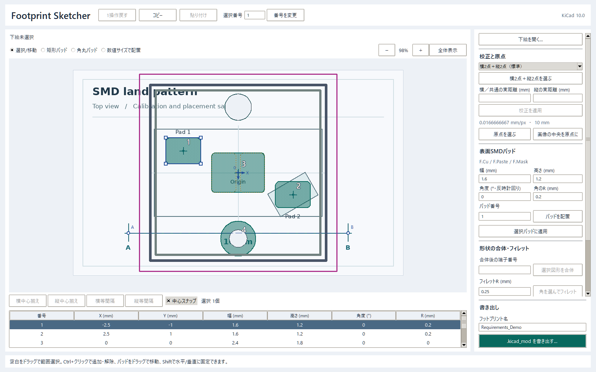

# KiCad Footprint Sketcher

データシートの寸法図を下絵にして、パッドや図形を配置し、KiCad 10向けのフットプリントを作るデスクトップGUIです。既知の寸法で画像を校正し、数値入力・複製・対称配置・拘束で形を整えます。編集内容は下絵ごと保存できます。

**現在はWindows向けの試用版です。** ソースから起動します。出力はKiCadで番号・寸法・面・穴・開口を確認してから使用してください。



*操作画面の例（Windowsでの検証時）。下絵とサンプルは操作確認用です。*

## できること

- PNG・JPEG・PDFを下絵にし、横／縦別の実寸校正、原点指定、拡大・移動。
- クリップボード画像やコピーした画像／PDFファイルを下絵へ取り込み、PDFはページを見ながら必要な範囲をドラッグで切り取り。
- 矩形・角丸などのSMDパッド、PTH／NPTH、線・円・円弧・多角形を作成。
- 数値寸法、番号変更、連続配置、範囲選択、コピー、反転、整列・等間隔、Undo。
- Customパッドへの合体、選択角フィレット、Mask／Pasteの設定・独立開口・Paste分割。
- 位置・寸法・中心の関係を保持する基本拘束、F／BのCu・Paste・Mask・SilkS・Fab・CrtYd編集。
- 下絵を内包した `.kfsproj` の保存・再開と、`.kicad_mod` の書き出し・対応要素の再編集。

[操作ガイド](docs/USAGE.md)に各操作と制限をまとめています。寸法やパッドを画像から自動認識する機能はありません。

## Windowsで起動する

必要なものは **Python 3.14（Tcl/Tkを含む）** です。出力確認には **KiCad 10.0系** を使います。検証環境はWindows 11 Pro／Python 3.14.4／KiCad 10.0.7です。

1. このリポジトリを取得します。Gitがある場合は次を実行します。Gitがない場合はGitHubの「Code → Download ZIP」で取得・展開してください。

   ```powershell
   git clone https://github.com/ReiA-O/kicad-footprint-sketcher.git
   cd kicad-footprint-sketcher
   ```

2. `README.md` と `requirements.txt` のあるフォルダーでPowerShellを開き、依存ライブラリを導入して起動します。

   ```powershell
   py -3.14 -m venv .venv
   .\.venv\Scripts\python.exe -m pip install -r requirements.txt
   .\.venv\Scripts\python.exe -m footprint_sketcher
   ```

仮想環境の有効化やPowerShell実行ポリシーの変更は不要です。次回からは最後の起動コマンドだけで開けます。

起動できない場合は `py -3.14 --version` と `.\.venv\Scripts\python.exe -m tkinter` を確認してください。後者でTkのテスト画面が開かない場合は、PythonのTcl/Tk導入を確認します。詳細は[起動時の確認](docs/USAGE.md#起動時の確認)を参照してください。

## まずサンプルを触る

1. 「ファイル → プロジェクトを開く…」で [`examples/requirements-demo/Requirements_Demo.kfsproj`](examples/requirements-demo/Requirements_Demo.kfsproj) を選びます。下絵・パッド・図形・拘束が入っています。
2. 「選択/移動」でパッドを選び、右側の幅を変更してEnterを押します。パッド1と2は対称・等寸法の拘束を持ち、相手も追従します。「1操作戻す」で戻せます。
3. 「ファイル → プロジェクトを保存…」で別名の `.kfsproj` を保存します。
4. 自分の出力先に `Practice.pretty` フォルダーを作り、「ファイル → KiCadへ書き出す…」でそのフォルダーを選びます。KiCad 10のフットプリントエディターから出力をインポートして確認します。

[KiCad出力例](examples/requirements-demo/Requirements_Demo.pretty/Requirements_Demo.kicad_mod)も同梱しています。最初から下絵を校正して作る場合は、[PNG・JPEGの10 mmサンプル手順](docs/USAGE.md#下絵から作る10-mmサンプル)を使ってください。

画面の切り抜きを使う場合は「画像を貼り付け」、PDFから選ぶ場合は「PDFを切り取る…」を使えます。[下絵の貼り付け・PDF切り取り手順](docs/USAGE.md#pdf下絵の差し替え)も参照してください。

## 対応範囲と検証状況

KiCad入出力は10.0系の形式 `20260206` が対象です。未対応の要素は原文を保持し、保全できない変更は保存を停止します。任意のKiCadファイルの全要素を編集できるものではありません。

Customパッド全体の幅・高さ・R変更と四隅リサイズ、Redo、画像の回転・せん断・台形補正、別ネット用Net-tieは未対応です。Customの寸法は合体前に調整してください。詳しくは[操作ガイドの制限](docs/USAGE.md#制限と既存ファイルの扱い)を参照してください。

Windowsで185件の自動試験と、KiCad 10.0.7で148出力の読戻し照合を実施しています。自動試験ではファイル選択の戻り値を指定し、出力はAPIで照合しました。通常ダイアログを含む最新の全手順と、全出力のKiCad画面／Windows Footprint Checker確認は未完了で、通常GUIでの操作・インポート・Checker実行による確認が必要です。[検証結果・再現条件・未確認事項](docs/verification/windows-strict-review-20261123/README.md)を公開しています。

## 不具合・要望

クリップボード／PDF取込みの[バグ再点検と修正記録](docs/verification/reference-import-review-20261123.md)も公開しています。

[GitHub Issues](https://github.com/ReiA-O/kicad-footprint-sketcher/issues)へ、再現手順、期待する動作と実際の動作、Windows／Python／KiCadの版を添えてください。画像やログから個人名・ローカルパス・機密情報を除いてから投稿してください。[報告と変更提案の案内](CONTRIBUTING.md)、[セキュリティ上の報告](SECURITY.md)も参照できます。

## 利用条件と開発資料

**利用・改変は許可、権利者の事前許可のない本体の再配布は禁止**です。GitHub標準のFork等は例外です。作成したフットプリントやプロジェクトには、この本体の再配布禁止を適用しません。詳しくは[LICENSE](LICENSE)を確認してください。

- [操作ガイド](docs/USAGE.md)・[変更履歴](CHANGELOG.md)・[テストの実行](docs/TESTING.md)
- [要件と実装の対応](docs/requirements-audit-20261123.md)・[要件定義書](files/要件定義書.md)・[開発運用](GOAL.md)
- [公開記録の匿名化と履歴の扱い](docs/PUBLICATION.md)

検証記録は環境情報を匿名化した公開用コピーです。記録中の古いコミット識別子は実行当時のもので、現在の公開履歴とは異なります。履歴変更前の作業コピーを使っている場合は、新しくcloneしてください。
