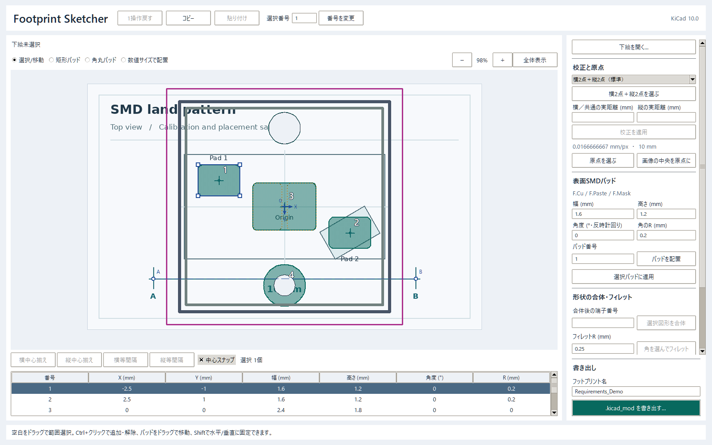
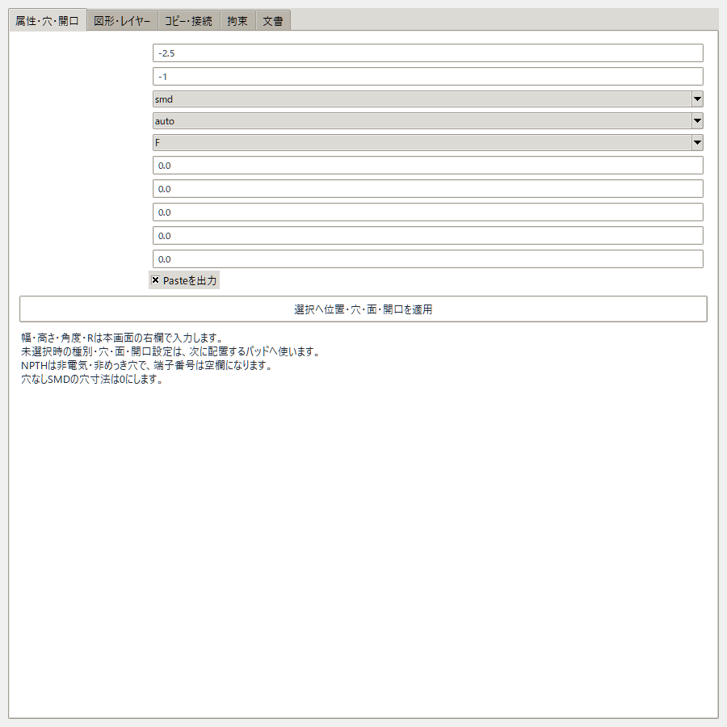

# 要件補完版のWindows実機検証（2026年11月23日）

**結論：追加範囲を含むWindows154件が全件通過し、KiCad 10.0.7で99出力の読戻しが一致しました。最新の本人操作感・標準ダイアログを含む全手順・KiCad画面／Windows Checkerと正式採否は未確認です。**

## 対象と実行環境

- 正本の基準はmain `a38e767a95b572133f71b0c4c457f541151ebac2`の要件v1.1／GOAL v1.0。本人は後続の確定要件も今回追加すると回答し、D03〜D09-AとD10の基本拘束R01〜R03を採用しました。今回の記録は作業ブランチの要件v1.8 §8.5.9／GOAL v1.7へ反映し、F01〜F08原文は保持しています。
- 検証したローカルソースは`1e0210c1655ff5aa146efb4597837a605c3c613d`。公開アプリコミット[`97f5bb000c94468fc910aa62ade47f752efb4f72`](https://github.com/ReiA-O/kicad-footprint-sketcher)と全リポジトリツリー`97ea567fbc1ac4ab3572b309d936b7912b5cd193`が完全一致します。認証ヘルパーの応答停止によりGitHub APIで公開し、元のローカル履歴も保持しています。本検証記録の文書追加は検証後の更新です。
- USERのWindows 11 PC、Python 3.14.4、Pillow 12.3.0、Shapely 2.2.0、NumPy 2.5.5、pypdfium2 5.15.2、KiCad 10.0.7を使用しました。実行環境の文字列とソースハッシュは[集計](summary.json)へ収録しています。
- 最終試験は2026年11月23日 **05:10:23〜05:12:29 JST**（2026年11月22日20:10:23〜20:12:29 UTC）。Windowsの対話デスクトップで実際のTkウィジェット、`event_generate`、ボタン呼出しを使い、通常ファイル選択の戻り値は検証コードから指定しました。

## 自動試験とKiCad読戻し

| 確認対象 | 結果 |
| --- | --- |
| Windows試験 | 純粋ロジック120件＋GUI34件＝154件通過。失敗・エラー・スキップ0件。 |
| KiCad読戻し | 99出力。標準Pad156個・Custom17個・Paste専用開口31個＝計204個、Graphic54個。照合失敗0件。 |
| 位置・寸法・R等の差 | 最大`4.996256657285869e-7 mm`。 |
| 角度・比率の差 | 0。 |
| 輪郭の差 | 双方向の頂点–辺距離の最大`4.966475205121781e-7 mm`。 |
| PNG／JPEG回帰 | 10 mm補助2点校正・原点・矩形／角丸の4出力が初回ファイルとバイト一致し、全8パッドの読戻し差0。ローカル比較でも一致を追認。 |

数値差は観測値です。読戻しの内部破損検知条件2 nm、拘束の内部残差条件、曲線折線化の条件を、未決T02の外部受入精度・性能・製造公差へ読み替えていません。番号・種別・形状・所属レイヤー、穴・開口属性、図形とCustom輪郭を期待モデルに対して照合しました。

[154件の実行受領票と全試験ログ](tests.json)、[99出力の照合一覧](readback.json)、[集計とハッシュ](summary.json)を収録しています。99例の完全な期待モデル・物理エンティティごとの差・全出力・PNG／JPEG回帰は[evidence.zip](evidence.zip)内の生JSONと`.pretty`にあります。

## 今回確認した主な追加機能

| 要件 | 確認した実装 |
| --- | --- |
| F01 | KiCadファイルの読込・編集／保持の分類・無編集原文往復、Reference／Value値だけの編集、保全不能な変更の停止。画像内包`.kfsproj`の保存再開と不正データの拒否。 |
| F02 | PDFのページ／整数px範囲、既存図形・拘束のmm座標を残す下絵追加／差替えと再校正・初回原点指定。 |
| F03 | 基本寸法・幾何拘束の追加変更解除、対称・等寸法等の変更への追従、状態表示、矛盾時の直前形状保護。円の等径・実半径、線の実長・等長、Customの3自由度。 |
| F04 | 矩形・角丸・線・円・3点円弧・閉じた多角形、独立した作図R、退化／自己交差の拒否。 |
| F05 | A→Bの基準点コピー、指定中心の点対称、任意軸の線対称、新番号／番号維持と形状・層・開口の保持。 |
| F06 | 不要パッドの削除、残る番号の保持、拘束参照の解除確認と再対応付け、Undo。 |
| F07 | 元パッド・番号・開口を残す同一ネット用Cu接続。幅0の元形状合成、正幅で一覧順の接続点を丸端Cuで結ぶ操作。 |
| F08 | F／Bの6層、PTH／NPTHと丸穴／長穴、NPTHの空番号、Mask／Pasteの有無・拡縮・独立形状・分割、レイヤー表示／ロック。通常SMDからのPaste分割でも世界Cu・Mask・窓間隔を保持。 |

要件との詳しい対応は[監査表の今回実装欄](../../requirements-audit-20261123.md)を参照してください。個別のテスト存在だけで、全使用条件や本人の操作感まで確認済みとはしていません。従来の[70件](../windows-enter-20261123/README.md)は旧範囲の履歴として残します。

## 途中で見つかった問題と再検証

| ソース | 当時の結果・修正 |
| --- | --- |
| `430784ed86f24d558d546f45e03c0c5d7d1896e4` | 136件で失敗2・エラー1。作図開始時に旧選択の種類／レイヤーが新設定へ上書きされるUI不具合を修正。NPTH穴のテスト文字列`1`／`1.0`の比較を修正し、UTF-8テストのCP932読込みを明示UTF-8へ修正。 |
| `387691e238b18e6746fd50a7d0fdeb77e7328263` | 144件は通過したが、KiCad読戻しでNPTH番号が空になる差を1例検出。モデルもNPTHを空番号へ正規化し、番号欄を無効にした。 |
| `c436ca872ed8139131c3d4e323eab17e9085fb27` | 154件中1件失敗。旧選択のため無効になったR欄を作図へ流用する不具合を、独立した「作図する角丸図形のR」欄へ変更して修正。 |
| `1e0210c1655ff5aa146efb4597837a605c3c613d` | 修正後154件通過、99出力のKiCad照合失敗0件。 |

未適用校正点と別編集のUndo順序の不整合にもガードと回帰試験を追加しました。全体開口設定の継承と個別の明示0、合体後Pasteの二重拡縮、新規パッドの意図しない継承も修正・回帰確認しました。形状変更時のgenerator更新と元generator_versionの除去、穴種別変更時の既知attr種別更新では、その他の属性を保持します。

[途中の実行受領票・再現ログ](attempts.json)と、生ログを含む過去3回のZIPも最終[evidence.zip](evidence.zip)内へ保持しています。

## 本人が操作できるデモと画面

- Windowsのデスクトップに「フットプリント 要件補完デモ」を用意し、Session 1でGUIの表示を確認しました。Canvasは1229×629、編集対象は8個、拘束は2件です。[GUI状態](gui-ready.json)。
- リポジトリでは[Requirements_Demo.kfsproj](../../../examples/requirements-demo/Requirements_Demo.kfsproj)を「プロジェクトを開く…」から開きます。[KiCad出力例](../../../examples/requirements-demo/Requirements_Demo.pretty/Requirements_Demo.kicad_mod)はWindowsのKiCad 10.0.7でPad／開口7個とGraphic3個の読込みを確認しました。これは操作確認用で、製造用部品の設計ではありません。
- [generate.py](../../../examples/requirements-demo/generate.py)でサンプルを再生成できます。プロジェクトのSHA256は`24a586dc1035dc51e6ff4be132725e1be0539c67f33957770734c0d2af9e849a`です。
- 以下は対象プロセスが所有するアプリのウィンドウだけをPrintWindowで撮影した記録です。[撮影情報](ui-capture.json)。属性画面では一部の静的ラベルが撮影されておらず、実画面の完全な再現や目視合格の代わりにはしません。

## 未確認と確認方法

| 未確認 | 理由 | 確認方法 |
| --- | --- | --- |
| 最新の操作感・見やすさ | 本人の最新の手操作結果をまだ受領していません。自動Tk操作の通過とは別です。 | デスクトップのデモで選択・寸法変更・拘束追従・作図・下絵追加・保存再開を操作します。 |
| 標準ダイアログを含む最新の全手順 | 自動試験ではファイル選択の戻り値を指定しています。 | 通常の「開く／保存／書き出し」でPNG／JPEG／PDF・プロジェクト・出力先を選びます。 |
| KiCadエディター画面・Windows Footprint Checker | 今回の99出力はAPIで照合しました。エディター表示・Checkerとは別です。 | 新しい`.pretty`内の出力をエディターへインポートし、属性・Cu／Mask／Paste・図形表示とCheckerを確認します。 |
| 最新版の正式採否 | 採用範囲の指示は受領済みですが、最新版全体の正式な採否は未記録です。 | 対象ソースと本人確認結果をPR #2へ記録して判断します。main反映は未実施で、自己マージはしません。 |

本人制作のNE555出力への「いい感じ」という[旧評価](../windows-enter-20261123/README.md)は、生成GUIコミット未特定の成果物に対する評価として保持し、今回版全体への承認へ転記していません。

T01-Bは今回の基本セットを独自NumPy方式で解く技術決定です。T02の外部受入精度・性能とT03の外部変更取込みは未決です。Net-tie、全KiCad要素編集、下絵自体の回転／鏡映、Redo、一般グリッド等の提案全体は一括採用していません。Customの全体W/H・全体R・四隅リサイズは引き続き非対応です。

## 証跡の所在

[試験・出力保存](harness/run_expanded_tests.py)／[期待モデル準備](harness/prepare_expanded_expected.py)／[KiCad照合](harness/read_expanded_kicad.py)／[PNG／JPEG回帰](harness/regression_expanded_png_jpeg.py)／[アプリ限定撮影](harness/capture_requirements_ui.py)。完全な[evidence.zip](evidence.zip)のSHA256は`d1256c146a7fabb7f67d844ba17fd7473bf08904d6ea3b399179fc8d19660644`で、ローカルでも一致を確認しました。生JSONのハッシュは[summary.json](summary.json)へ記録しています。PRは作業ブランチの更新として扱い、mainへの自己マージと次段階への移行は行っていません。
